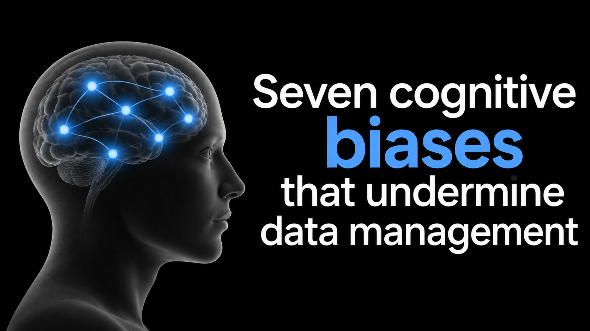

Nobody plans for their data to be a mess. Unorganised, ambiguous or difficult to understand. Few people believe that providing proper documentation and structure is a waste of time.

The principles of transparent, reproducible and open science are not controversial. Project leaders say that data are a key deliverable of their project. Grant applications increasingly include data management commitments or plans. Researchers say they will work on their data as soon as X, Y or Z.

These intentions are sincere. Yet the gap between those intentions and reality is a gaping chasm. A 2017 survey of 1,200 researchers found that 34% do not publish their data at all, and fewer than 15% share data in an actual repository[^1]. Of the data that are published, an alarmingly small proportion of datasets adhere to the FAIR principles[^2], with interoperability and reusability particularly lacking[^3].

These numbers should surprise no one in academia. If awareness were the problem, it would be solved by now. So why doesn’t knowing translate into doing?

I try to have open discussions with the researchers I work with about this. I often sense a feeling of guilt or failure on their part. Sometimes I feel the same. Am I expecting too much of them? Am I offering enough support? The truth is, this is not about individuals not doing their bit. It is not about laziness, nor, generally speaking, is it a reluctance to share their data — though I certainly observe the latter from time to time. It is not even, usually, about a lack of technical solutions — though we can do more to simplify the process. It is, first of all, about biases and how our brains work.

## How we are programmed to deprioritise data management

Biases influence the actions of everyone — researchers, project managers and funders alike. Below are just a few relevant examples.

### Present bias

Data management has close to the worst possible reward structure. The costs are immediate and certain: hours of tedious work now. The benefits are distant and probabilistic: some unnamed future person, possibly your future self, might reuse the data. Academics are busy people, and there is always something more time-pressing to prioritise: teaching, supervision, grant applications, the next paper.

Early data publication — as soon as the data have been processed and quality controlled — is rarely incentivised, so it is often postponed, even though it would likely take far less time and effort while the data and associated metadata are still fresh in the researcher’s mind. Field experiments show that people systematically delay tasks that require a lot of effort, even when the delay is demonstrably counterproductive[^4]. Interestingly, when given the chance, many choose to set binding deadlines for themselves, which suggests they recognise this tendency and want something to hold them to the task. In the absence of deadlines, data publication is often left for “later”.

### Optimism about future effort

“Later” is usually further away than people initially expect. We are overly optimistic about our future capacity, despite knowing only too well that in academia, one busy period is usually closely followed by another. At the same time, we underestimate how much time and effort future tasks will require[^5]. Experiments exploring the planning fallacy have shown that people usually underestimate how long their own tasks will take even when they know that similar tasks have run over before[^6].

### Action bias

People, and organisations, prefer visible action over invisible inaction, even when inaction is better. The tendency shows up everywhere, from goalkeepers diving the wrong way at penalties to doctors over-prescribing. Publishing a paper is an action. It is seen and read, it gets credit, it is considered when you apply for jobs or grants. If your paper is high impact, it might even get media attention. Academic careers are built on paper publication.

Data publication is much less visible. Not quite inaction, but academics certainly deprioritise it over more active, rewarding tasks. If we are to have any hope of changing this, we need to reward data publication much more than we do today.

### Boredom, delay and forgetting

Recent work shows that tasks perceived as boring are systematically delayed and eventually forgotten[^7]. Boredom undermines prospective memory — the cognitive ability to remember to perform a planned action or intention at a future point in time.

### Diffusion of responsibility

Some research projects today include hundreds of individuals from dozens of institutions. Data collection is planned to reduce duplication of effort, with individual datasets contributing to several different areas of research. This is a good thing. But one caveat comes from the classic bystander effect[^8]. That is, the more people who can act, the less likely any single one is to do so. This can, of course, be addressed with pre-planning and allocation of responsibility and resources.

### Social norms

People take cues from what others around them do[^9]. If most researchers in a field do not publish their data, that becomes the socially acceptable standard. Nobody decides that poor practice is acceptable. It just becomes the default.

## How these biases combine

The effects compound. Present bias says the work will be postponed. Optimism says the postponement is cheap. Boredom ensures the intention is forgotten. Diffusion of responsibility means nobody else picks it up, and action bias directs attention to something more visible in the meantime. Social norms make all of this feel normal. At no point in this chain does anyone decide that data management doesn’t matter.

But humans perform mundane, unrewarding tasks all the time if they are properly incentivised or required to do so. From housework to administrative tasks, we can all name examples. It is clear that the right incentives or consequences can counterbalance these biases. The fact that so much data remains unpublished suggests that the current academic system is not doing this effectively.

## Biases in funding

Innovation bias suggests that there is a wider cultural preference for innovation over maintenance. We have a tendency to celebrate novelty and discovery while undervaluing the upkeep that makes them possible[^10]. Research funding shows the same pattern. Grants are typically built around projects, which suits building new things better than long-term care of what already exists. Analysis of open infrastructure grants found that launching new things is well funded while keeping them running is not[^11], and surveys of researchers developing software report that maintenance is frequently excluded from project funding[^12].

When funding and careers reward new things over upkeep, there is little incentive to resist any of the individual biases.

## How to turn the tide

So how can we build a system that rebalances the scales in favour of data management?

### Require a plan, and fund it

Every funded project should have a data management plan, as research councils such as the Research Council of Norway already require. Following up on plans is a challenge, but they are a necessary starting point. A good plan acts as a commitment device, setting dates for publishing each data product, and it counters the bystander effect by naming who is responsible, whether an individual, a team or an institution.

Requirements without money are only mandates, so funding should also be set aside specifically for the work. In a comment published in Nature in 2020, Barend Mons argued that, on average, 5% of research costs should go to data stewardship[^13]. Funders could consider withholding a portion of the funding until after the data are published, so the reward for data work is no longer distant and uncertain. Data management plans could also be peer reviewed to check that they follow established best practices concerning data formats, standards and repositories, and that their timelines are acceptable and realistic. Making plans openly available could allow funders, data repositories and journals to track whether they are being followed.

### Data publication before manuscript submission

Journals hold the reward researchers want most, so they are well placed to change behaviour. Journals should require that the data behind a manuscript are published in a repository before submission. This not only incentivises earlier data publication, it also benefits the review process: transparent research depends on reviewers being able to access the data behind the manuscript. This requirement could be paired with better knowledge of data publication best practices on the journal side. At present, a box can often be ticked simply by depositing data somewhere that issues a DOI, often with no requirement to ensure that the data are optimised for discovery and reuse.

### Make the invisible visible

Publication is rewarded because it can be seen and counted. Data publication needs the same treatment. Repositories should track and display data reuse and citation counts, alongside measures of data quality.

### Reward data publication

Job and funding applications should consider data publication alongside paper publication, favouring those with a track record of publishing FAIR data early in a project lifecycle. A system that values data providers reaps the community benefits of plentiful data available to all shortly after collection. This must be paired with good ethics in data reuse: credit the creators, and for recently published data, consider contacting them before reuse to ensure you are not duplicating work already in progress.

### Do it when it’s cheap

Documentation costs the least at the moment of creation, when the context is fresh. Metadata should be documented when a dataset is collected or created, not afterwards.

### Streamline the process

Good data management can take time, so more resources should go into making FAIR publication easy: automated metadata capture, and software that makes it easier to encode data in standardised data formats. The development of such tools costs little next to some of the frontier expeditions that generate huge amounts of useful data — a rounding error in comparison. Investing in infrastructure to simplify publishing data from those expeditions helps ensure they are available to others who could not take part, and the return on that investment is likely to be huge.

## From good intentions to good data

Nobody plans for their data to be a mess, and nobody decides that data management doesn’t matter. The intentions have always been there. What has been missing is a system that makes acting on them the easy, visible and rewarded choice. Change that, and the chasm between intention and reality will start to close.

## References

[^1]: Cousijn, H. *Open Data: the researcher perspective - survey and case studies*. Mendeley. <https://doi.org/10.17632/BWRNFB4BVH.1> (2017).

[^2]: Wilkinson, M. D. et al. *The FAIR Guiding Principles for scientific data management and stewardship*. Scientific Data 3, 160018 (2016). <https://doi.org/10.1038/sdata.2016.18>.

[^3]: Dunning, A., De Smaele, M. & Böhmer, J. *Are the FAIR data principles fair?* (2017).

[^4]: Bisin, A. & Hyndman, K. Present-bias, procrastination and deadlines in a field experiment. *Games and Economic Behavior* 119, 339–357 (2020).

[^5]: Breig, Z., Gibson, M. & Shrader, J. *Why Do We Procrastinate? Present Bias and Optimism*. SSRN Electronic Journal (2019). <https://doi.org/10.2139/ssrn.3445511>.

[^6]: Buehler, R., Griffin, D. & Ross, M. Exploring the ‘planning fallacy’: Why people underestimate their task completion times. *Journal of Personality and Social Psychology* 67, 366–381 (1994).

[^7]: Haas, M. & Martarelli, C. S. From delay to forgetting: how boredom and procrastination disrupt prospective memory. *Humanities and Social Sciences Communications* 13, 1177 (2026).

[^8]: Darley, J. M. & Latané, B. Bystander intervention in emergencies: Diffusion of responsibility. *Journal of Personality and Social Psychology* 8, 377–383 (1968).

[^9]: Cialdini, R. B., Reno, R. R. & Kallgren, C. A. A focus theory of normative conduct: Recycling the concept of norms to reduce littering in public places. *Journal of Personality and Social Psychology* 58, 1015–1026 (1990).

[^10]: Russell, A. & Vinsel, L. *Innovation is overvalued. Maintenance often matters more*. Aeon Essays (2016). <https://aeon.co/essays/innovation-is-overvalued-maintenance-often-matters-more>.

[^11]: Tsang, E. et al. *2026 State of Open Infrastructure Report*. Zenodo (2026). <https://doi.org/10.5281/zenodo.21977759>.

[^12]: Jensen, E. A. & Katz, D. S. Evolving funding strategies for research software: Insights from an international survey of research funders. *PLOS One* 20, e0329833 (2025).

[^13]: Mons, B. Invest 5% of research funds in ensuring data are reusable. *Nature* 578, 491–491 (2020).
